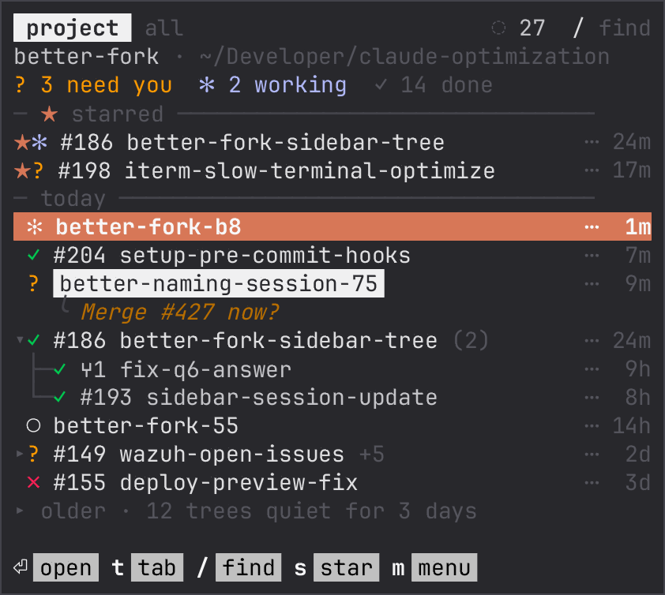
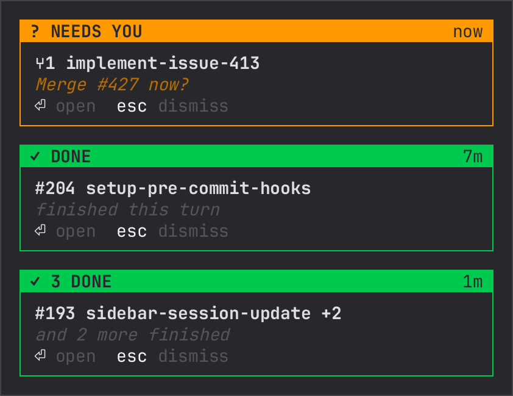
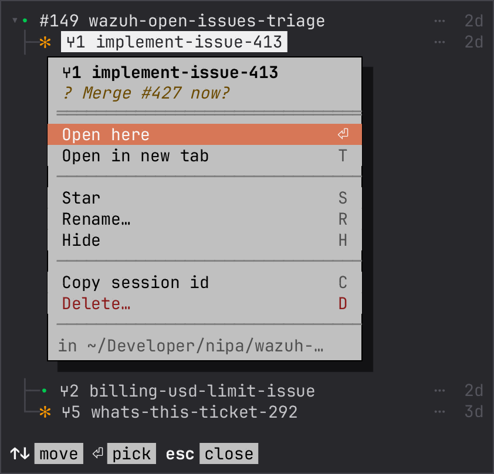
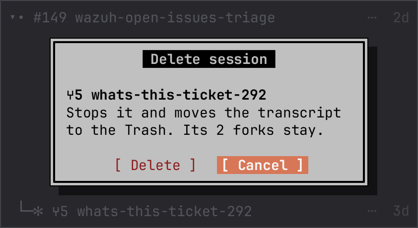
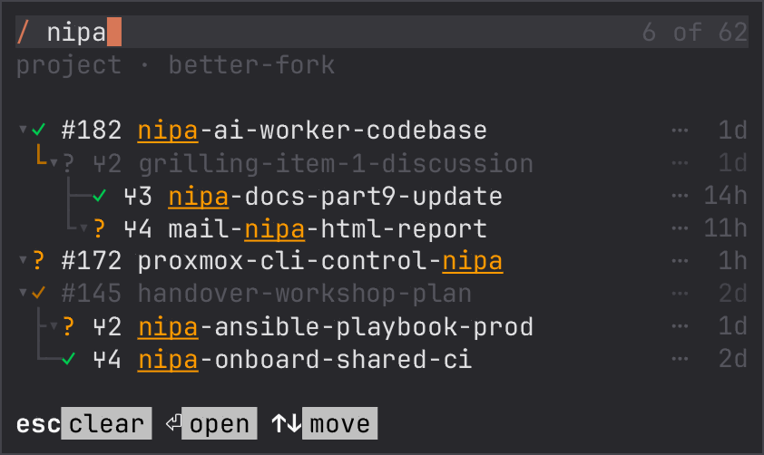
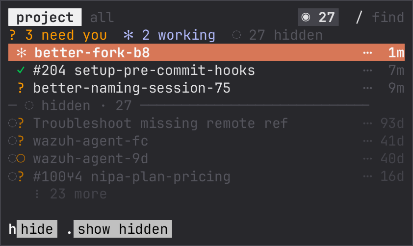
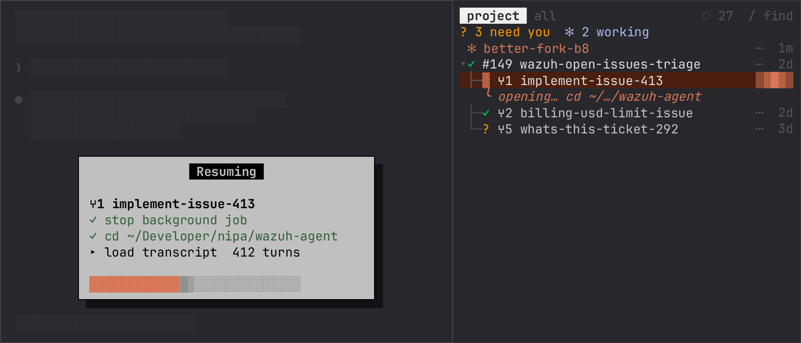
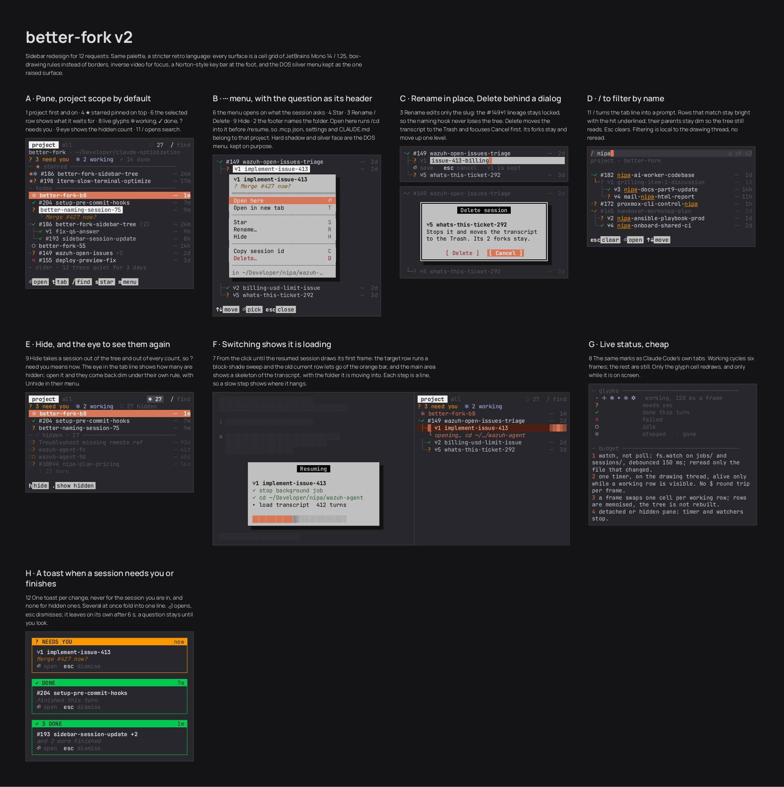
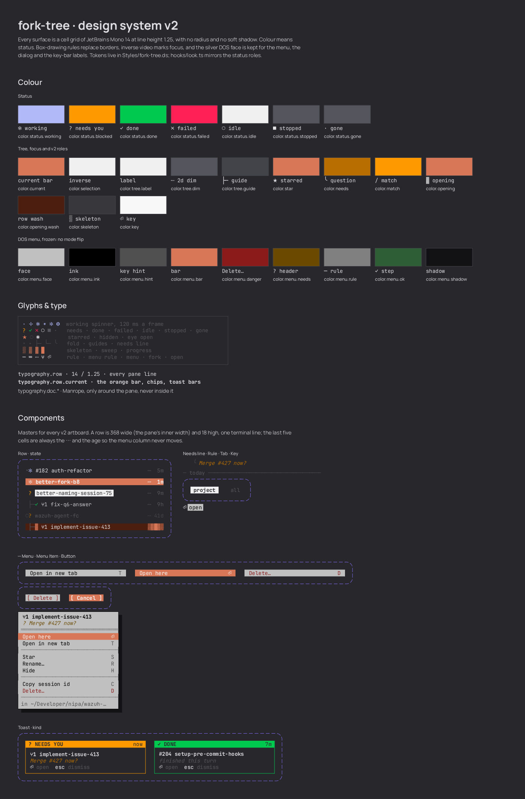

<div align="center">

# better-fork

**Every Claude Code session you've started, as one tree beside your chat.**



[Features](#features) · [Install](#install) · [Mouse](#mouse) · [How it works](#how-it-works) · [Design](#design) · [Development](#development)

</div>

<br>

Fork a session a few times and `/resume` turns into a flat list of look-alike names. better-fork draws them the way you made them: each fork under the session it came from, with a live mark for what it is doing. Interactive tabs, background jobs and closed transcripts all sit in one pane, and any of them is one click away.

## Features

### See what needs you

```
✻ working   ✻ needs you   • done   • failed   ○ idle   • stopped   · gone
```

The marks are the same ones Claude Code uses in its own tabs. Working sessions spin; the rest stay still. The header counts what needs you and what is working, and the selected row spells out the question it is waiting on.

When a session asks something or finishes a turn, a toast says so, never for the session you are already in. Several at once fold into one line. A question stays for fifteen seconds; the rest leave after six.

<p align="center">
  
</p>

### Act on any row

Click the `⋯` column and the menu opens on what the session is asking. Open it here or in a new tab, star it, rename it, hide it, copy its id, or delete it.

<table>
  <tr>
    <td width="50%"></td>
    <td width="50%"></td>
  </tr>
  <tr>
    <td><b>The menu.</b> Silver, hard shadow, a key label per item. The footer names the folder the session opens into.</td>
    <td><b>Delete.</b> The transcript goes to the Trash, Cancel has focus, and the forks move up a level instead of vanishing.</td>
  </tr>
</table>

Rename edits only the slug. The `#149⑂1` lineage stays locked, so the tree never loses track of who forked whom.

### Find it, or put it away

<table>
  <tr>
    <td width="50%"></td>
    <td width="50%"></td>
  </tr>
  <tr>
    <td><b><code>/</code> to filter.</b> Matches stay bright, their parents stay dim so the tree still reads. Empty the field to clear.</td>
    <td><b>Hide.</b> A hidden session drops out of the tree and every count, so <i>need you</i> means now. The eye brings them back.</td>
  </tr>
</table>

The pane opens on this project, worktrees included. One click on `all` shows every session on the machine. Starred sessions stay pinned on top, a quiet subtree folds after a day, and trees quiet for three days go under one "older" row.

### Switch without breaking anything

<p align="center">
  
</p>

From the click until the resumed session draws its first frame, the target row sweeps and the main area shows each step: stop the job, change folder, load the transcript. A slow step shows exactly where it hangs.

better-fork picks the move that interrupts nothing:

1. A session already open in another iTerm tab is focused, not reopened.
2. A session from another project opens in a new tab, since `/resume` only finds this project's transcripts.
3. A background session mid-turn opens in a new tab rather than being cut off.
4. An idle background session is stopped, then resumed right here, in its own folder, so its `.mcp.json`, settings and `CLAUDE.md` come with it.

## Install

You need [Claude Code](https://claude.com/claude-code) with mod support. On macOS, [iTerm2](https://iterm2.com) lets better-fork focus and open tabs; anywhere else, "new tab" copies the command for you to paste.

This repo doubles as a plugin marketplace called `local-mods`:

```bash
git clone https://github.com/Nonnyss/better-fork.git
claude plugin marketplace add ./better-fork
claude plugin install better-fork@local-mods
```

The pane opens in every new session. Run `/better-fork` to open it by hand.

> [!TIP]
> The mod is read straight from the clone. After a pull, run `/reload-plugins` in each open session. A session still on the old copy says so on its status line.

## Mouse

The sidebar is driven by the mouse. The letters in the menu and the key bar are labels, not shortcuts: a single key typed into the sidebar would fight Claude Code's prompt for it.

| Action                                                 | Click                                        |
| ------------------------------------------------------ | -------------------------------------------- |
| Open in this terminal                                  | The row                                      |
| Fold or unfold                                         | The caret                                    |
| Open in a new tab, star, rename, hide, copy id, delete | `⋯`, then the item                           |
| Filter by name                                         | `/ find` in the header, then type; `⏎` opens |
| Show hidden sessions                                   | The eye                                      |
| Save or cancel a rename                                | `⏎ save` or `esc cancel` under the field     |

A menu closes when the pointer leaves the sidebar.

## How it works

While the pane is on screen, better-fork watches two folders and rereads only the file that changed:

| Source                        | What it holds                                                            |
| ----------------------------- | ------------------------------------------------------------------------ |
| `~/.claude/jobs/*/state.json` | Background jobs, the same data as Claude Code's background-sessions view |
| `~/.claude/sessions/*.json`   | Live processes, interactive tabs included                                |

A session's parent comes from `forkParentSessionId`. When that is missing, the name carries the lineage: `#182⑂2⑂1-slug` is the first fork of the second fork of #182. Sessions that share a name, as happens after a resume, merge into one row. A detached or hidden pane stops every timer and watcher.

```
better-fork/
├── .claude-plugin/plugin.json
├── hooks/
│   ├── register.tsx    hooks, pane state and render
│   ├── sources.ts      reads sessions from disk
│   ├── tree.ts         sessions → rows, pure
│   ├── look.ts         glyphs, colours, row geometry
│   ├── switch.ts       open here or in a new tab
│   └── tree-view.tsx   drawing thread: pointer, menu, rename field
└── types/index.d.ts
```

## Design

Everything inside the pane is a cell grid of JetBrains Mono 14 at line height 1.25. Box-drawing rules stand in for borders, inverse video marks focus, colour only ever means status, and a DOS-silver face is kept for the one raised surface: the menu. The designs live in [`main.bl`](main.bl), drawn in [Brilliant](https://brilliant.design); the tokens in [`Styles/fork-tree.ds`](Styles/fork-tree.ds), mirrored by `hooks/look.ts`.

<details>
<summary><b>Every screen</b></summary>
<br>



</details>

<details>
<summary><b>Design system</b>: colour, glyphs, type and components</summary>
<br>



</details>

## Development

From the repo root:

```bash
claude plugin test better-fork       # run every test
(cd better-fork && tsc -p .)         # type-check
claude plugin validate better-fork   # what the engine would refuse
```

> [!IMPORTANT]
> The engine writes `better-fork/.claude-plugin/types/` the first time it loads the mod, and the folder is gitignored. Load the mod once before you type-check.
